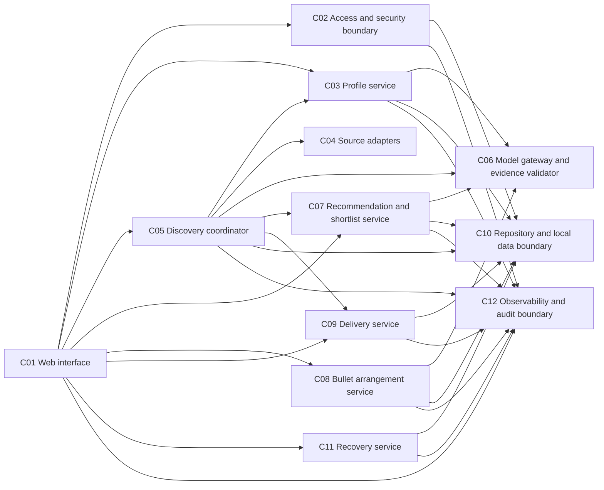

# Consolidated application design

Status: Generated under approved component plan and asynchronous scan choice; approved in chat; see audit.md. This document consolidates the component, method, service and dependency specifications below. No implementation, library compatibility or external access is validated by this design.

## Architecture decisions

- Retain one modular local FastAPI/Uvicorn product process/worker, with Jinja views, typed contracts and explicit gateway/repository ports.
- User-requested scans return persisted ID/status promptly. A repeated trigger returns the active run; UI polls; timer/startup/manual triggers use one lock. Interrupted work is marked interrupted on restart; one due catch-up follows the accepted policy.
- Canonical confirmed profile versions and actual listing evidence are immutable references. Deterministic code owns freshness, status, dedup, validation, persistence and notifications; model proposes typed extraction/tool/explanation/bullet outputs within bounded authority.
- Security-critical access, key/secret, data and audit boundaries are separately owned. Single-user/local does not waive authenticated access, TLS, encryption or protected audit retention. Isolated local facilities may be required; mechanism selection is deferred to explicit NFR/Infrastructure gates.
- No cloud hosting, production HA topology, additional user role, automatic application, outreach, calendar integration or new resume text is added.

## Deferred decisions and gates

Functional Design: exact DTO/schema bounds, algorithms, transaction/scan/delivery state machines, conflict/deletion semantics, whole-scan/tool-round budgets and per-unit PBT properties. NFR Requirements: supported/pinned framework and dependency selection, including PBT. NFR Design: specific local auth/keys/encryption/HTTPS/audit mechanisms and recovery retention/key rescue, explicit CI/rollback/deployment-style/incident and resilience-test decisions. Infrastructure Design: concrete local permissions, secure startup/configuration and isolation. Construction: implement, test, vulnerability-scan, restore-drill, validate live API/model access and measure fixture results. Do not silently present deferred controls as implemented or approved mechanism choices.

Business criticality: low/non-production for all local components, with security/integrity-sensitive failure modes explicitly identified in components.md. Delivery risk remains high due to the accepted uplift and limited course timeline. RTO 4 hours/RPO 24 hours remain recovery targets, not a claim of continuous service while closed. No production SLA is invented.

## Requirement and story coverage

| ID | Owning / collaborating components |
|---|---|
| FR-01 | C01,C02,C03,C06,C10 |
| FR-02 | C03,C07,C10 |
| FR-03 | C04,C05,C10 |
| FR-04 | C01,C05,C10 |
| FR-05 | C04,C07 |
| FR-06 | C06,C07 |
| FR-07 | C07,C10 |
| FR-08 | C09,C10 |
| FR-09 | C08,C06,C10 |
| FR-10 | C03,C07,C10,C11,C12 |
| NFR-01 | C01,C10 |
| NFR-02 | C04,C05,C06,C09,C10 |
| NFR-03 | C05,C07,C09,C10 |
| NFR-04 | C10,C11 |
| NFR-05 | C01 |
| NFR-06 | C02,C04,C05,C06 |
| NFR-07 | C12 and team PR process |
| NFR-08 | C12 |
| NFR-09 | All component test ports and Construction tooling |
| US-01 | C01,C03,C06 |
| US-02 | C03,C10 |
| US-03 | C03,C07,C10 |
| US-04 | C04,C05,C06 |
| US-05 | C04,C10 |
| US-06 | C01,C05,C10 |
| US-07 | C04,C07 |
| US-08 | C06,C07 |
| US-09 | C07,C10 |
| US-10 | C01,C09 |
| US-11 | C09,C10 |
| US-12 | C08,C06,C10 |
| US-13 | C03,C10,C11,C12 |
| US-14 | C01,C02,C10,C12 |
| US-15 | C04,C05,C06,C07,C09,C10,C12 |
| US-16 | C10,C11,C12 |
| US-17 | C12 |
| US-18 | All components and reproducible fixtures |
| MVP-01 | C03,C06,C10 |
| MVP-02 | C04,C05,C07 |
| MVP-03 | C06,C07 |
| MVP-04 | C07,C10 |
| MVP-05 | C09,C10 |
| MVP-06 | C08,C06,C10 |

## Consolidated component specification

# Components

Status: Generated from approved Application Design plan; approved in chat; see audit.md. Interfaces are logical contracts, not implemented modules. One product process/worker is retained; HTTPS, key custody, storage encryption and protected logging may use separate local facilities with distinct permissions. Detailed mechanisms are not silently chosen here.

## C01: Web interface

Authenticated HTML/JSON routes, schema validation, escaped views and CSRF/headers. Delegates commands to services; never issues raw SQL/provider calls. Polls persisted scan status.

- Coverage: FR-01..10; NFR-05; US-01..18.
- Dependencies: C02,C03,C05,C07,C08,C09,C11,C12.
- Workload classification/impact: Low business criticality; absence prevents local interaction but cannot submit applications.

## C02: Access and security boundary

Local principal/session validation, object/function authorization, secret/key references and transport/security policy ports. Deny by default; explicitly public bootstrap/health routes must be separately enumerated during NFR Design.

- Coverage: SEC-REQ-01/03/04/05/06/07; US-14.
- Dependencies: C10,C12.
- Workload classification/impact: Low business criticality, security-critical control: failure denies access rather than bypassing checks.

## C03: Profile service

Import proposals, extraction validation, claim provenance, conflict review, confirmation and immutable version references. Changes mark previous explanations outdated. Does not fabricate claims or select unresolved conflicts.

- Coverage: FR-01/02/10; MVP-01; US-01/02/03/13.
- Dependencies: C06,C10,C12.
- Workload classification/impact: Low; interruption delays profile setup. Confirmed claims remain persisted.

## C04: Source adapters

Normalized Adzuna/USAJOBS search ports, pasted text storage and explicit fixture replay. Retain actual text, provenance and date precision; no automatic arbitrary URL or LinkedIn fetch.

- Coverage: FR-03/05; MVP-02; US-04/05/07.
- Dependencies: None internally; external API and credential ports.
- Workload classification/impact: Low; each unavailable source yields partial results and source-specific status.

## C05: Discovery coordinator

Single lock and bounded shared scan entry point for timer/manual/startup. Persists run ID/status, captures profile version, dispatches approved tool requests, coordinates evidence normalization and matching, then schedules delivery.

- Coverage: FR-03/04/05; NFR-02/03; US-04/06/07/15.
- Dependencies: C03,C04,C06,C07,C09,C10,C12.
- Workload classification/impact: Low; interruption delays scans, not applications. Locks/unfinished runs recover explicitly.

## C06: Model gateway and evidence validator

Bounded profile/relevance/bullet calls with explicit provider configuration. Returns typed proposals, supported tool intents and evidence references; validates syntax and domain references before use. No authority to write profile/status or send mail.

- Coverage: FR-01/06/09; NFR-06; US-01/08/12/15.
- Dependencies: None internally; external model/credential ports.
- Workload classification/impact: Low; failure leaves source facts visible and explanation unavailable.

## C07: Recommendation and shortlist service

Freshness classification and deterministic eligibility/unknown handling; confirmed-profile fit explanations, persisted source evidence, canonical identity/dedup, save/hide transitions and evidence views.

- Coverage: FR-05/06/07; MVP-03/04; US-07/08/09.
- Dependencies: C06,C10,C12.
- Workload classification/impact: Low; failure retains last results and statuses; no unverified match implied.

## C08: Bullet arrangement service

Selected-job proposal of ordered unique confirmed IDs, original-text rendering and explicit acceptance/rejection. Stores accepted arrangement separately from canonical claim text.

- Coverage: FR-09; MVP-06; US-12.
- Dependencies: C06,C10,C12.
- Workload classification/impact: Low; unavailable suggestions do not block job review.

## C09: Delivery service

In-app result views and opted-in email to the fixed configured recipient. Consent snapshot and current opt-in checked before sending; delivery attempts tracked separately. No model-selected recipient or outreach.

- Coverage: FR-08; MVP-05; US-10/11.
- Dependencies: C10,C12; external SMTP/credential ports.
- Workload classification/impact: Low; SMTP outage preserves in-app results and visible delivery status.

## C10: Repository and local data boundary

Transactional repositories, immutable version IDs, listing/status/run/delivery records and unit-of-work protocol. Uses encryption/key-custody ports; plaintext SQLite is not a compliant default. Data deletion includes dependent records and backup-deletion markers.

- Coverage: FR-02/07/10; NFR-01/04; SEC-REQ-01/08; US-03/09/13/16.
- Dependencies: None internally; encrypted storage/key ports.
- Workload classification/impact: Low business criticality, integrity-sensitive; access/storage failure prevents writes and returns safe error.

## C11: Recovery service

Consistent encrypted snapshots, encrypted backup inventory, restore/validation and restart recovery. RTO 4 hours/RPO 24 hours; retention, cadence and key-recovery concrete decisions are NFR Design outputs. Applies deletion markers before restored data becomes visible.

- Coverage: NFR-04; RESILIENCY-11/12/13; US-16.
- Dependencies: C10,C12; backup/key ports.
- Workload classification/impact: Low; backup failure alerts user and prevents false protection claims; data-loss impact is explicit.

## C12: Observability and audit boundary

Structured redacted event writer, protected centralized collector port, metrics/health/status and security/backup failure signals. Collector permissions separate append from edit/delete; app cannot erase its audit trail.

- Coverage: NFR-08; SEC-REQ-02/08; US-13/17.
- Dependencies: None internally; separately protected collector/alert ports.
- Workload classification/impact: Low business criticality, audit-sensitive; failure policy separates prohibited unaudited critical changes from safe read-only views.

## External and trust boundaries

Browser input -> authenticated/validated C01/C02 -> services -> C10 data and C12 audit ports. Resumes, pasted job text, source API text and model proposals are untrusted. Only C04 performs source retrieval; C06 proposes tool intents but C05 validates and dispatches them. C09 alone can send result email after consent. Providers receive only the text required for the selected task. Secrets are injected as opaque references, not returned in domain objects or logs.

No cloud IAM, load balancer, CDN, production zones or multi-user account platform is introduced. Roles in README are team responsibilities, not application privileges.

## Consolidated interface specification

# Component methods and contracts

Status: Logical typed interface specification; not executable Python. Detailed validation bounds, state-machine rules, persistence schemas and per-unit properties belong to Functional/NFR Design.

## Shared vocabulary

| Type | High-level fields / constraints |
|---|---|
| Principal | Authenticated local identity and server-validated authorization context; never supplied as trusted input by a browser/model. |
| Result[T] | Success value or typed error: validation, unauthorized, forbidden, not_found, conflict, timeout, rate_limited, unavailable, partial. User-facing errors are safe; diagnostics are redacted. |
| SourceRef / Evidence | Immutable source ID, source kind, original text reference/span, URL or local evidence link, retrieved time and published-time precision. |
| Claim / ProfileVersion | Claim ID, original text, source IDs, review status; confirmed version ID with confirmed claims and preferences. |
| Listing | Stable local ID, canonical source identity, title/employer/location, actual received text, evidence and explicit unknown/date fields. |
| ScanRun / ScanReceipt | Run ID, trigger, captured profile version, lifecycle, per-source outcomes and timestamps; receipt is active/new plus status URL. |
| Explanation | Listing ID, captured profile version, confirmed claim IDs and listing spans, gaps/unknowns, validation status. |
| ArrangementProposal | Proposal ID, listing/version IDs, ordered unique confirmed bullet IDs and source refs; no new text. |
| DeliveryAttempt | Run ID, configured-recipient reference, consent version, status and attempt ID; no sensitive values in generic logs. |
| BackupManifest | Snapshot/version IDs, encryption-key reference, integrity metadata, time and deletion-generation marker; never raw key material. |
| AuditEvent | Actor/request/run IDs, action, timestamp, object/version references, before/after metadata excluding private text and secrets. |

IDs are distinct domain types, not interchangeable strings. All public methods require authenticated/authorized context or a constrained scheduler/service identity established by the app. IDs must be checked for ownership even in a single-user deployment. Ports return immutable values; storage mutation occurs only through a unit of work.

## Methods by component

| Owner | Signature | Contract / effects |
|---|---|---|
| C01 | start_scan(request: ScanCommand, context: RequestContext) -> Result[ScanReceipt] | POST /api/scans validates auth/CSRF and delegates. New scan returns 202 with persisted ID/status URL; active scan returns 200 with that ID, not another queue entry. |
| C01 | scan_view(scan_id: ScanId, context: RequestContext) -> Result[ScanView] | GET /api/scans/{id} authorizes ownership; pending/running/partial/succeeded/failed/interrupted status and safe results; no side effects. |
| C01 | render_profile / render_shortlist(context: RequestContext) -> Result[HtmlView] | Escaped accessible views; approved security headers; authorized local evidence URLs. |
| C02 | authenticate(session: SessionReference) -> Result[Principal] | Validate expiry/invalidation and reject unauthorized sessions; exact session mechanism later. |
| C02 | authorize(principal: Principal, action: Action, resource: ResourceRef) -> Result[AuthorizedContext] | Deny default; ownership/function checks, no reliance on UI hiding. |
| C02 | secret_ref(purpose: AllowedPurpose) -> Result[SecretHandle] | Scoped access for permitted adapters, no plaintext serialization/logging; managed by secure configuration. |
| C03 | propose_profile(inputs: ImportBatch, context: AuthorizedContext) -> Result[ProfileDraft] | Extract source-linked claims and mark conflicts; no confirmed mutation. |
| C03 | confirm_profile(draft_id: DraftId, edits: ReviewDecisions, expected_version: VersionId, context: AuthorizedContext) -> Result[ProfileVersion] | Atomically save confirmed version and invalidate/mark prior explanations; optimistic conflict returns conflict. |
| C03 | confirmed_profile(context: AuthorizedContext) -> Result[ProfileVersion] | Return current confirmed immutable snapshot for capture at scan start. |
| C03 | delete_profile(expected_version: VersionId, context: AuthorizedContext) -> Result[DeletionReceipt] | Atomically remove dependent private records and record deletion generation; backup treatment disclosed and applied on restore. |
| C04 | search(query: ValidatedSearch, source: SupportedSource, budget: CallBudget) -> Result[SourceBatch] | Adzuna/USAJOBS only, source credentials resolved outside input; bounded HTTP, source-specific failure. |
| C04 | ingest_pasted(text: BoundedText, url: Optional[SourceUrl], context: AuthorizedContext) -> Result[EvidenceListing] | Store supplied text; URL is attribution, not instruction to fetch. |
| C04 | replay_fixture(fixture_id: FixtureId) -> Result[SourceBatch] | Explicit synthetic/demo provenance. |
| C05 | request_scan(trigger: Trigger, context: AuthorizedContext) -> Result[ScanReceipt] | Atomically join active run or create pending run; capture profile version; submit bounded local work. |
| C05 | execute_scan(run_id: ScanId, budget: ScanBudget) -> Result[ScanOutcome] | Transition running, dispatch allowlisted intents, collect per-source outcomes, stage validated results and schedule delivery; cleanup releases lock. |
| C05 | recover_startup(clock: Clock) -> Result[RecoverySummary] | Mark persisted pending/running work interrupted, load saved results, initiate one initial/due catch-up under lock. |
| C06 | extract(inputs: ImportEvidence, budget: CallBudget) -> Result[ClaimProposal] | Bounded provider result, structural and provenance validation. |
| C06 | plan_tools(profile: ProfileVersion, context: SearchContext, budget: CallBudget) -> Result[List[ToolIntent]] | Allowlisted typed intents only; coordinator owns actual tools and budgets. |
| C06 | explain(profile: ProfileVersion, listing: Listing, budget: CallBudget) -> Result[ExplanationProposal] | Propose evidence-linked fit/gaps; validate references, not pretend to prove semantic truth solely via IDs. |
| C06 | arrange(profile: ProfileVersion, listing: Listing, budget: CallBudget) -> Result[ArrangementProposal] | Ordered subset of confirmed IDs; original text rendered by app, not generated text. |
| C07 | normalize_and_merge(batch: SourceBatch, context: AuthorizedContext) -> Result[List[Listing]] | Preserve actual evidence and source facts, deduplicate transactionally without losing statuses. |
| C07 | evaluate(profile: ProfileVersion, listings: List[Listing], budget: ScanBudget) -> Result[RecommendationBatch] | Code applies freshness/known constraints; validated explanations reference captured profile, no quota padding. |
| C07 | set_status(listing_id: ListingId, status: UserStatus, expected_revision: Revision, context: AuthorizedContext) -> Result[ListingView] | Explicit save/hide or supported status update; no application inferred from view. |
| C07 | shortlist(query: ShortlistQuery, context: AuthorizedContext) -> Result[ShortlistView] | Source labels, profile version, gaps, freshness and saved statuses. |
| C08 | propose(listing_id: ListingId, context: AuthorizedContext) -> Result[ArrangementProposal] | Retrieve current confirmed profile and actual listing; validate model-proposed ID subset. |
| C08 | decide(proposal_id: ProposalId, decision: AcceptOrReject, expected_version: VersionId, context: AuthorizedContext) -> Result[ArrangementDecision] | Reject leaves profile unchanged; stale version returns conflict; accept stores arrangement separately without rewriting claims. |
| C09 | configure_delivery(settings: DeliverySettings, context: AuthorizedContext) -> Result[ConsentVersion] | User only; validate recipient, explicit opt-in, audit consent metadata. |
| C09 | deliver(run_id: ScanId, context: ServiceContext) -> Result[DeliveryAttempt] | Persist in-app view first; recheck opt-in and fixed recipient before SMTP; track ambiguity/failure without claiming exactly-once mail delivery. |
| C10 | transaction(operation: ValidatedOperation, context: AuthorizedContext) -> Result[CommittedChange] | Parameterized repository operations, encryption at rest, version checks and redacted audit/outbox intent; no network/provider calls held inside DB transaction. |
| C10 | snapshot(context: RecoveryContext) -> Result[ConsistentSnapshot] | Consistent database plus upload/evidence manifest; no naive copy of an actively written SQLite file. |
| C10 | restore(snapshot: VerifiedSnapshot, deletion_generation: Generation, context: RecoveryContext) -> Result[RestoreReceipt] | Maintenance-mode transactional restore, preserve post-snapshot deletion policy, validate before reopening writes. |
| C11 | backup_due(clock: Clock, context: RecoveryContext) -> Result[BackupReceipt] | Scheduled encrypted backup meeting 24-hour RPO during active use; update inventory only after integrity checks. |
| C11 | restore(backup_id: BackupId, context: RecoveryContext) -> Result[RecoveryReport] | Key/snapshot verification, maintenance mode, restore, deletion handling and saved-state validation under 4-hour target; no false success. |
| C12 | emit(event: RedactedEvent, context: AuditWriterContext) -> Result[AuditReceipt] | Append to protected collector; app has no update/delete capability. Audit write failure prevents unaudited critical mutation per later failure policy. |
| C12 | health(context: AuthorizedContext) -> Result[HealthView] | Process/DB/scan/backup/delivery health, last success and alert states without secrets. |

## Boundary rules

All ID-based fetches enforce ownership. Source fetches use 15-second timeout, model calls 45 seconds, at most one transient retry respecting provider guidance. Overall tool rounds, payload sizes, polling cadence and per-store/SMTP limits are explicit Functional/NFR Design outputs, not unlimited loops. Sessions, secret encryption keys and provider instances do not cross into generic DTOs. Missing facts remain unknown. Model proposal schemas are not substitutes for deterministic validation or factual-evidence review.

## Consolidated orchestration specification

# Services and orchestration

Status: High-level orchestration from approved plan, asynchronous scan contract selected. No runtime mechanisms implemented.

## S01: Profile preparation and confirmation

C01/C02 authenticate and validate import -> C03 registers evidence -> C06 extracts typed claims -> C03 flags conflict/unconfirmed claims -> C01 displays original source references -> user confirms/corrects -> C03/C10 atomically commit a new confirmed version with audit metadata via C12. Rejected/unconfirmed claims do not enter matching. Concurrent version edits fail with conflict. Private import content is bounded and never logged. Confirmation invalidates or explicitly marks old-version explanations.

## S02: Discovery and scan lifecycle

C01 authenticated POST, local four-hour timer and startup all call C05.request_scan. Under one lock, return active ID if a scan exists; otherwise persist a pending run and profile-version snapshot, then return its ID before background work. UI polls an authorized status read. A process stop is not a promise of durable background execution: pending/running rows are marked interrupted at startup. One initial/due catch-up follows the approved clock policy; do not resume an old task that could send stale mail.

C05 invokes C06 for bounded allowlisted tool intents; C05 validates intent/source/budget and dispatches C04. C04 normalizes real received evidence, including snippet/full-text distinctions. Pasted/fixture sources use the same evidence boundary but are explicitly labeled. C07 merges identities and preserves saved/hide statuses, applies freshness and known requirement constraints, then obtains validated explanations through C06. No worthwhile matches is a successful empty outcome.

The captured profile version remains fixed throughout a run. If the user changes it mid-run, store results as belonging to the older version and mark them outdated; never silently attach them to the new profile. Source success/failure is recorded independently; a failed source cannot advance its success watermark. A scan may finish partial with useful factual listings even when one source or explanation call fails.

C05 commits source facts/results/status separately from delivery. No provider HTTP is held inside a long DB transaction. Every path records safe terminal status and releases the shared lock. Exact overall scan budget and retry/backoff policy beyond accepted per-call bounds belong to Functional/NFR Design. Polling itself never triggers another scan.

## S03: Shortlist and evidence review

C01/C02 -> C07 reads authorized source/profile snapshots and renders freshness, gaps, unknown fields and provenance. Save/hide commands carry expected revision and update status through C10 with redacted audit events. Status and canonical identity survive refresh/restart. Viewing a role never marks it applied. Source/evidence views are authenticated, escaped, local or supported links; a source URL is not permission to fetch it.

## S04: Selected-job bullet arrangement

User selects listing -> C08 loads confirmed profile/listing -> C06 proposes bullet IDs -> C08 verifies unique ordered subset and renders original confirmed text. Proposal has captured version/expiry state. Accept revalidates version and saves only the arrangement, not rewritten claim text. Reject does not mutate profile. If source claims were changed/deleted, proposal is stale and must be regenerated/reviewed.

## S05: Delivery

Results are already persisted for in-app use before C09 considers mail. C09 checks server running, valid recipient and explicit current consent; model/tool content cannot choose a destination. Delivery stores attempt/status separate from scan/source success. A user disabling email prevents later sends not already handed to SMTP. An ambiguous SMTP outcome is recorded as uncertain and not blindly retried after restart, avoiding a false exactly-once guarantee. Detailed bounded retry/send locking is Functional Design work. SMTP failure preserves in-app results; closed app sends nothing.

## S06: Access, safe errors and audited changes

C02 provides local-principal authentication/authorization to every resource route and service mutation, including scan/evidence/deletion/recovery. Security policies belong in dedicated modules, not templates. C01 handles request-level CSRF, size/format bounds, escaped HTML and required HTTPS/security-header policy; C10 uses parameterized queries and encryption ports. C06/C04 output is untrusted and cannot bypass these checks.

The logical audit protocol prepares a redacted event/outbox intent with a data change and obtains a durable collector receipt before treating a security-critical change as successfully complete. Exact transaction/collector failure reconciliation must be defined and tested in NFR/Functional Design; do not claim two-store atomicity. If protected logging is unavailable, fail closed for critical writes and offer only authorized safe reads. Collector runs with distinct permissions so app credentials cannot delete/edit audit records. No raw resume, secret, recipient or private listing payload is emitted into logs.

Misuse scenarios: a malicious listing requests email to another address; a resume injects instructions to invent qualifications; a browser requests another object's ID; a forged/expired session submits a write. In every case typed permissions, validation, captured evidence IDs and explicit user consent block the action, with redacted failure audit/alerts.

## S07: Backup, restore and deletion

C11 schedules encrypted consistent backups via C10 snapshot port, preserving manifests, required uploads/evidence and key references. The accepted goal is at most 24 hours of active-use state loss; backup schedule/retention and post-closure behavior are selected during NFR Design, not inferred as a promise of a running background daemon. A backup is successful only after encrypted artifact integrity checks. Failures appear in C12 status.

Restore enters maintenance mode, verifies keys and backup integrity, restores data, applies deletion generation/tombstones, checks profile/status consistency and performs an authorized smoke check before reopening. If checks fail retain the failed state for diagnosis without exposing private content; report safe failure. Record restore/failback and user communication steps; demonstrate RTO within 4 hours in Construction. Deletion must cover associated current data and disclose backup retention/expiry, with safeguards so restoration does not silently resurrect deleted profiles. Protected audit retention uses non-content IDs, not a second raw-data copy.

## S08: Observability and repeatable evaluation

C12 records structured correlation IDs, metrics and source/scan/delivery/backup states through a centralized protected collector. UI status/alerts show failures and last success. Health checks for local critical dependencies do not perform uncontrolled paid model calls. One process does not require distributed tracing; request/scan IDs correlate external operations.

All provider, clock, repository, SMTP, key and audit ports support deterministic doubles. Example fixtures demonstrate complete journeys; per-unit Functional Design identifies PBT invariants and stateful models; NFR Requirements selects framework; Construction configures shrinking/replay and CI. Generated tests do not claim real-model relevance or universal factual grounding.

## Consolidated dependency specification

# Component dependencies and communication

Status: Logical dependency and data-flow model. Arrows mean calls through typed ports, not unmediated trust. No circular application dependency is required. Scheduler/task invocations use constrained service context; caller authorization is established outside low-level adapters.

## Dependency matrix

| Caller | Direct application dependencies | Communication |
|---|---|---|
| C01 | C02, C03, C05, C07, C08, C09, C11, C12 | Typed in-process service/repository ports; external boundaries only through adapters. |
| C02 | C10, C12 | Typed in-process service/repository ports; external boundaries only through adapters. |
| C03 | C06, C10, C12 | Typed in-process service/repository ports; external boundaries only through adapters. |
| C04 | None | External provider/storage/collector ports as defined in components.md; no reverse service callback. |
| C05 | C03, C04, C06, C07, C09, C10, C12 | Typed in-process service/repository ports; external boundaries only through adapters. |
| C06 | None | External provider/storage/collector ports as defined in components.md; no reverse service callback. |
| C07 | C06, C10, C12 | Typed in-process service/repository ports; external boundaries only through adapters. |
| C08 | C06, C10, C12 | Typed in-process service/repository ports; external boundaries only through adapters. |
| C09 | C10, C12 | Typed in-process service/repository ports; external boundaries only through adapters. |
| C10 | None | External provider/storage/collector ports as defined in components.md; no reverse service callback. |
| C11 | C10, C12 | Typed in-process service/repository ports; external boundaries only through adapters. |
| C12 | None | External provider/storage/collector ports as defined in components.md; no reverse service callback. |

## Dependency/data-flow diagram

### Text alternative

Browser -> C01 web -> C02 access before authorized services. C03 profile -> C06 extraction and C10 persistence. C05 discovery -> C03 confirmed snapshot, C04 adapters and C06 bounded tool plan -> C07 validated recommendations -> C10 results -> C09 opt-in delivery. C08 bullet review -> C06 ID proposal and C10 acceptance. C11 snapshot/restore -> C10. Relevant services emit C12 redacted events; C12 exposes no delete/update audit port. C10 does not call application services, preventing repository/service cycles.

## Trust and runtime boundaries

| Boundary | Payload / rule |
|---|---|
| Browser -> app | Local HTTPS, secure session, auth/ownership/CSRF and bounded schema validation. No trusted principal from request JSON. |
| Upload/pasted text -> C03/C04/C06 | Untrusted evidence; ID/span provenance, immutable source references, size/format controls. |
| C05 -> C04 -> job APIs | Fixed supported hosts, scoped key handle, validated query, 15-second source bounds and normalized actual response. |
| C03/C05/C07/C08 -> C06 -> configured model | Minimum task-required evidence; 45-second per-call bound, at most one transient retry, strict typed proposal/tool validation. No implicit fallback/provider change. |
| Services -> C10 | Authorized transactions, version checks, encrypted stores and protected key reference. Storage failure fails closed. |
| Services -> C12 collector | Structured redacted events; separately controlled collector permissions, minimum 90-day security retention and alert routing. App has no audit delete privileges. |
| C09 -> SMTP | Revalidated opt-in/recipient, encrypted transport, delivery status independent of scan success; no model destination. |
| C11 -> backup store | Consistent encrypted snapshot/manifest and integrity verification; restore maintenance mode and deletion-generation handling. |

## Coordination and failure boundaries

The one-process scan lock prevents timer/manual/catch-up overlap. Persisted IDs support UI progress, but a process crash interrupts work rather than guaranteeing queue replay. Repository transactions exclude network calls. Concurrent profile/status changes use version/revision checks. C05/C07 handle partial source/model failures without falsifying dates or success timestamps. Secrets/key material remain behind scoped ports. The separate logging/storage protection details, secure local process topology and library choices must be resolved in NFR/Infrastructure Design before implementation; this diagram is not a deployment security proof.
