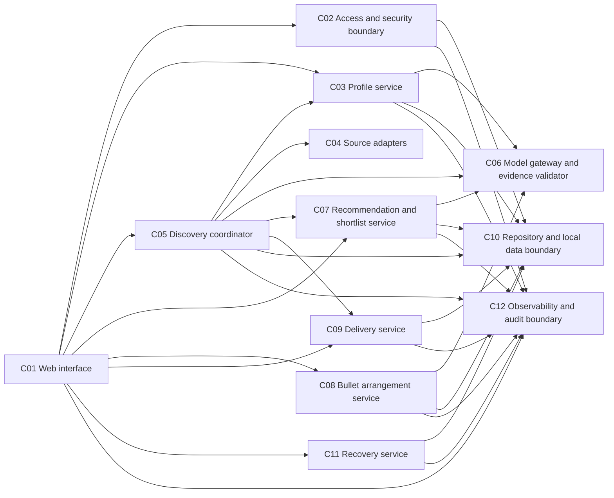

# Component dependencies and communication

Status: Logical dependency and data-flow model. Arrows mean calls through typed ports, not unmediated trust. No circular application dependency is required. Scheduler/task invocations use constrained service context; caller authorization is established outside low-level adapters.

## Dependency matrix

| Caller | Direct application dependencies | Communication |
|---|---|---|
| C01 | C02, C03, C05, C07, C08, C09, C11, C12 | Typed in-process service/repository ports; external boundaries only through adapters. |
| C02 | C10, C12 | Typed in-process service/repository ports; external boundaries only through adapters. |
| C03 | C06, C10, C12 | Typed in-process service/repository ports; external boundaries only through adapters. |
| C04 | None | External provider/storage/collector ports as defined in components.md; no reverse service callback. |
| C05 | C03, C04, C06, C07, C09, C10, C12 | Typed in-process service/repository ports; external boundaries only through adapters. |
| C06 | None | External provider/storage/collector ports as defined in components.md; no reverse service callback. |
| C07 | C06, C10, C12 | Typed in-process service/repository ports; external boundaries only through adapters. |
| C08 | C06, C10, C12 | Typed in-process service/repository ports; external boundaries only through adapters. |
| C09 | C10, C12 | Typed in-process service/repository ports; external boundaries only through adapters. |
| C10 | None | External provider/storage/collector ports as defined in components.md; no reverse service callback. |
| C11 | C10, C12 | Typed in-process service/repository ports; external boundaries only through adapters. |
| C12 | None | External provider/storage/collector ports as defined in components.md; no reverse service callback. |

## Dependency/data-flow diagram

### Text alternative

Browser -> C01 web -> C02 access before authorized services. C03 profile -> C06 extraction and C10 persistence. C05 discovery -> C03 confirmed snapshot, C04 adapters and C06 bounded tool plan -> C07 validated recommendations -> C10 results -> C09 opt-in delivery. C08 bullet review -> C06 ID proposal and C10 acceptance. C11 snapshot/restore -> C10. Relevant services emit C12 redacted events; C12 exposes no delete/update audit port. C10 does not call application services, preventing repository/service cycles.

## Trust and runtime boundaries

| Boundary | Payload / rule |
|---|---|
| Browser -> app | Local HTTPS, secure session, auth/ownership/CSRF and bounded schema validation. No trusted principal from request JSON. |
| Upload/pasted text -> C03/C04/C06 | Untrusted evidence; ID/span provenance, immutable source references, size/format controls. |
| C05 -> C04 -> job APIs | Fixed supported hosts, scoped key handle, validated query, 15-second source bounds and normalized actual response. |
| C03/C05/C07/C08 -> C06 -> configured model | Minimum task-required evidence; 45-second per-call bound, at most one transient retry, strict typed proposal/tool validation. No implicit fallback/provider change. |
| Services -> C10 | Authorized transactions, version checks, encrypted stores and protected key reference. Storage failure fails closed. |
| Services -> C12 collector | Structured redacted events; separately controlled collector permissions, minimum 90-day security retention and alert routing. App has no audit delete privileges. |
| C09 -> SMTP | Revalidated opt-in/recipient, encrypted transport, delivery status independent of scan success; no model destination. |
| C11 -> backup store | Consistent encrypted snapshot/manifest and integrity verification; restore maintenance mode and deletion-generation handling. |

## Coordination and failure boundaries

The one-process scan lock prevents timer/manual/catch-up overlap. Persisted IDs support UI progress, but a process crash interrupts work rather than guaranteeing queue replay. Repository transactions exclude network calls. Concurrent profile/status changes use version/revision checks. C05/C07 handle partial source/model failures without falsifying dates or success timestamps. Secrets/key material remain behind scoped ports. The separate logging/storage protection details, secure local process topology and library choices must be resolved in NFR/Infrastructure Design before implementation; this diagram is not a deployment security proof.
