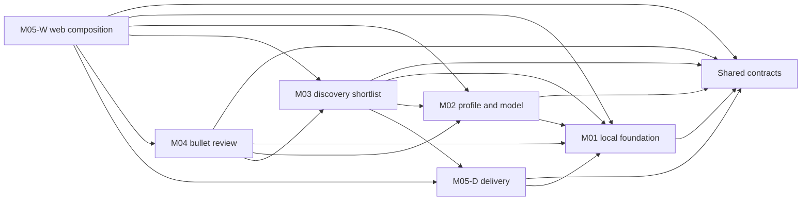

# Unit and module dependencies

Status: Generated; approved in chat; see audit.md. U01 is the only application unit. It has no other application-unit dependency. External providers and local secure facilities are ports, not additional product units.

## Unit dependency matrix

| Unit | Depends on another application unit | External requirements |
|---|---|---|
| U01 job-application-agent | None | Configured model, job-source APIs when enabled, optional SMTP, secure storage/key/HTTPS/audit/backup facilities selected during design. |

## Internal module/sub-boundary matrix

Arrows and rows mean consumer depends on provider. M05 has two sub-boundaries: M05-D delivery C09 and M05-W web C01. They are not sixth/seventh modules or extra deployments. Collapsing them would misleadingly suggest M03 <-> M05: C05 calls C09, while C01 calls C05. At the actual component/sub-boundary level there is no cycle; delivery never imports web/discovery.

| Consumer | Required providers | Checkpoint |
|---|---|---|
| Contracts | None | Contract-compatible typed interfaces; dependency tests and doubles before integrated flow. |
| M01 | Contracts | Contract-compatible typed interfaces; dependency tests and doubles before integrated flow. |
| M02 | Contracts, M01 | Contract-compatible typed interfaces; dependency tests and doubles before integrated flow. |
| M05D | Contracts, M01 | Contract-compatible typed interfaces; dependency tests and doubles before integrated flow. |
| M03 | Contracts, M01, M02, M05D | Contract-compatible typed interfaces; dependency tests and doubles before integrated flow. |
| M04 | Contracts, M01, M02, M03 | Contract-compatible typed interfaces; dependency tests and doubles before integrated flow. |
| M05W | Contracts, M01, M02, M03, M04, M05D | Contract-compatible typed interfaces; dependency tests and doubles before integrated flow. |

## Internal dependency diagram

### Text alternative

Contracts have no feature dependencies. M01 uses contracts. M02 and M05-D use M01/contracts. M03 uses M02 for confirmed profiles/model, M01 for persistence/security, and M05-D for delivery. M04 uses M02/M03 and foundation. M05-W composes all modules last. Domain/foundation/delivery never import web assembly. Shared ports are injected by src/app/main.py; validation and permissions apply at every boundary.

## External dependencies and isolation

| Dependency | Owner | Failure/validation contract |
|---|---|---|
| Adzuna US / USAJOBS | M03 C04 | Fixed supported hosts and scoped credentials; actual response evidence; source-specific safe failure; bounded calls and saved fixtures. |
| Planned configured model/provider | M02 C06 | Typed extraction/tool/explanation/bullet proposals only; fixed budgets, strict validation, no silent provider switch. Actual access/compatibility must be verified before implementation relies on it. |
| SMTP | M05-D C09 | Explicit current opt-in and validated configured recipient; TLS; attempted/uncertain/failed state separate from source/scan success. |
| Encrypted stores and key custody | M01 C02/C10 | Customer-controlled/managed-key boundary, version checks and transactions; never infer encryption from SQLite or local-only storage. |
| Protected centralized collector | M01 C12 | App append-only capability, no audit edit/delete, redaction/90-day retention and alerts; audit failure policy gates critical mutations. |
| Encrypted backup/restore | M01 C11 | Consistent snapshot, manifest/integrity/key/deletion handling, RTO 4 hours/RPO 24 hours; restore tested later. |
| Local HTTPS/session controls | M01 plus M05-W | Loopback-bound approved secure runtime, authenticated resource access, sessions/CSRF/headers; mechanisms selected during NFR/Infrastructure Design. |

## Integration sequence and safeguards

Use the sequence in unit-of-work.md. Contracts and foundation first; profile/model and delivery port next; then discovery, bullet review and web assembly. This is an internal order, not parallel-agent authorization or separate workflows. Across all packages preserve profile version, evidence IDs, scan run state, source success watermark, saved status and recipient-consent version. Audit/outbox and storage changes need explicit failure reconciliation; no distributed transaction guarantee is invented. Perform module tests at each boundary and complete end-to-end/restore tests before final U01 acceptance.
