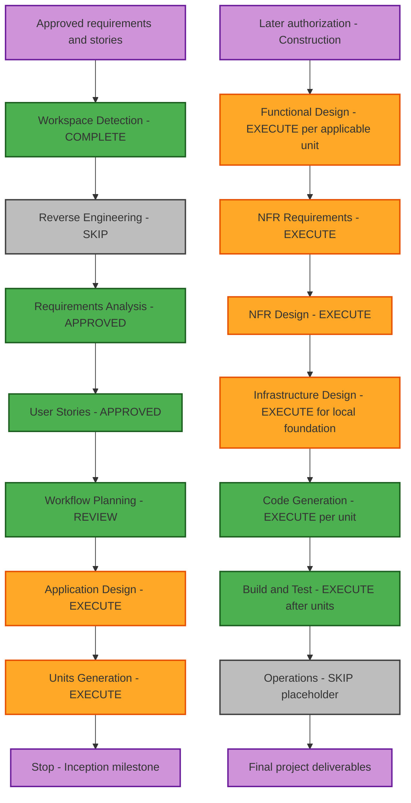

# Execution plan

Status: Execution plan approved in chat; see audit.md. Requirements and 2 personas/18 stories are approved. Application Design is the next proposed stage. This document does not authorize Construction.

## Detailed analysis summary

### Scope and impact

Greenfield local single-user product; no application code/build system exists yet. Brownfield transformation, cross-package migration and package update sequencing are N/A.

| Impact | Assessment |
|---|---|
| User-facing | Six MVP features spanning import/confirmation, scheduled discovery, grounded fit, shortlist, delivery and reviewed existing-bullet arrangement. |
| Structure | New web routes, services, adapters, shared schemas and persistence boundaries need explicit design. |
| Data | Claims/provenance, profile versions, actual listing evidence, statuses, scan/delivery records, accepted arrangements, audit metadata and backup inventory. Exact schemas are design outputs. |
| APIs | Validated local endpoints and bounded tools for Adzuna/USAJOBS and stored/pasted jobs; no LinkedIn automation. |
| NFRs | Full enabled security, local recovery targets, timeout/degradation behavior, generated testing and reproducible evaluation significantly affect all units. |
| Infrastructure | Local HTTPS, encrypted stores/backups, secret custody, isolated/protected logging and local access control require deployment mapping; no public cloud topology. |
| Operations | Define health/alerts, backups and recovery within design/Construction; Operations remains an excluded placeholder. |

### Risk assessment

Delivery risk: High relative to a course timeline, chiefly due to the full accepted security uplift plus retrieval/model access, extraction quality and email reliability. Business criticality remains low/non-production; these are different measures. Rollback complexity: moderate because confirmed profiles, statuses and key/backup compatibility must survive changes. Test complexity: moderate-to-high across state transitions, generated properties and failure paths. Actual engineering estimates require approved unit boundaries and team capacity.

The existing four-part collaboration plan defines review responsibilities; it does not substitute for cohesive implementation units or authorize assigning unclaimed roles. Respect current claims and review cross-part contracts together.

## Workflow visualization

### Text alternative

Current Inception path: Workspace Detection complete -> Reverse Engineering skipped -> Requirements approved -> User Stories approved -> review this Workflow Plan -> Application Design -> Units Generation -> stop for milestone review.

Separate future authorization: per-unit Functional Design -> NFR Requirements -> NFR Design -> local Infrastructure Design where applicable -> Code Generation; repeat for each approved unit; after all units, Build and Test -> final deliverables. Operations is skipped. The diagram intentionally has no automatic edge from the milestone stop to Construction.

## Phase selection and depth

| Stage | Decision | Depth and reason |
|---|---|---|
| Workspace Detection | COMPLETE | Reuse greenfield determination. |
| Reverse Engineering | SKIP | No existing application implementation; course artifacts are not an implemented legacy system. |
| Requirements Analysis | APPROVED | Six MVPs, FR-01..10, NFR-01..09, enabled security/resilience/PBT obligations. |
| User Stories | APPROVED | Two synthetic personas, 18 journey-based stories with acceptance and mappings. |
| Workflow Planning | REVIEW | Standard depth, with risk, stage choices and review gates. |
| Application Design | EXECUTE | Standard depth: new components, responsibilities, interfaces, service interactions, dependency and trust boundaries. All stage-defined artifacts required. |
| Units Generation | EXECUTE | Standard depth: coherent units, dependencies, story/requirement coverage and recommended order. All three required unit artifacts plus stage plan. |
| Functional Design | FUTURE EXECUTE per applicable unit | Data/provenance rules, matching validation, freshness, dedup, confirmation, stateful consent; identify PBT properties. Pure configuration units may skip with rationale. |
| NFR Requirements | FUTURE EXECUTE | Carry security, recovery, framework selection, resource and timeout bounds into every affected unit. |
| NFR Design | FUTURE EXECUTE | Select local encryption/access/logging/backup/session mechanisms and ask explicit CI/rollback/deployment/incident/test-process questions at this permitted stage. |
| Infrastructure Design | FUTURE EXECUTE for local foundation | Map HTTPS, encrypted persistence, secrets, protected logs and backups to actual local runtime services/permissions. Skip duplicate mapping for feature units reusing approved foundation; no cloud resources implied. |
| Code Generation | FUTURE EXECUTE per unit | Plan -> explicit approval -> implementation and appropriate example/PBT tests -> review; no work started now. |
| Build and Test | FUTURE EXECUTE after all units | Reproducible build, generated/example/integration/error-path/security/recovery evidence and required instructions. |
| Operations | SKIP / PLACEHOLDER | Not required by assignment; runtime safeguards and recovery tests remain Construction obligations. |

## Remaining Inception deliverables and gates

1. Review and explicitly approve this execution plan, or revise stage selection.
2. Application Design: load stage rules, prepare a concrete plan/questions, resolve open component/interface decisions, generate all required architecture artifacts, and obtain review approval.
3. Units Generation: load stage rules and approved design, plan decomposition, generate unit-of-work.md, unit-of-work-dependency.md and unit-of-work-story-map.md, validate all stories/requirements are assigned without cycles, and obtain review approval.
4. Milestone review: check input/README consistency, answered decision files, required artifacts, stage/audit records and installed AI-DLC v1.0.1 verification. Do not silently add or infer approvals. Stop before Construction.

## Construction handoff and coordination

Candidate coordination sequence, not final units: first establish validated shared contracts and local security/persistence foundations, then profile/evidence processing and retrieval normalization, then matching/shortlist/bullet review, then scheduling/email and integrated demo/recovery tests. Units Generation decides final boundaries and dependency order. No independent agents or parallel workflows are authorized by this plan. Team members may work through branches under the shared workflow after unit approvals.

Require explicit contracts for claim/profile version IDs, listing identity and timestamp precision, source evidence, scan status/lock semantics, saved status, recipient consent, accepted bullet IDs, deletion and backup/audit boundaries. Preserve IDs through storage and model validation. Cross-unit integration checks are planned at each handoff; do not wait until the final demo to discover incompatible schemas.

## Quality and extension gates

- Every approved FR, NFR and story maps to design components and units; preserve all six MVPs and excluded features.
- Security outcomes must have concrete local mechanisms and verification evidence before personal-data implementation/demo. Plain HTTP or plain SQLite cannot be presented as satisfying encryption requirements.
- Recovery remains explicit Backup and Restore, RTO 4 hours/RPO 24 hours with encrypted consistent backups, restore validation, retention/deletion and key recovery decisions. No production availability SLA is invented.
- Design-stage user decision prompts required by resiliency rules remain explicit gates, not choices made by the model.
- Full PBT property identification, framework selection, generators/shrinking/replay, stateful/oracle tests and CI/test instructions remain scheduled alongside example tests. Generated tests mock live provider boundaries.
- Input/model/source identifiers are documented planned choices; access, current compatibility and actual price/dependency facts must be verified before choosing implementation details that rely on them.
- Reassess each extension rule per stage. See workflow-extension-compliance.md; no runtime compliance or production readiness is claimed.

## Time and success criteria

Milestone deadline: November 24, 2026, 11:59 PM America/New_York. Final project deadline: December 16, 2026. No unsupported completion-time estimate is promised. Two design/decomposition stages remain after this plan is approved; each retains its mandatory review gates. Forecast implementation duration only after unit decomposition and capacity review.

Inception success: approved and mutually consistent inputs, requirements, personas/stories, execution plan, application design and complete dependency/story-mapped units; complete audit/state; repository submission checks complete. Construction success later requires a working local end-to-end demo and measured tests, not documentation alone.

## Plan progress

- [x] Load approved inputs, requirements, answered questions, stories/personas and extension coverage.
- [x] Assess scope, risks and stage applicability; distinguish delivery risk from business criticality.
- [x] Define remaining Inception deliverables and future Construction handoff.
- [x] Validate workflow syntax, references, stage counts and text alternative before file creation.
- [x] Create execution plan and per-rule extension coverage.
- [x] Present review decision and record approval request in audit.
- [x] Receive explicit execution-plan approval or changes.
- [x] Continue to Application Design only after approval.
